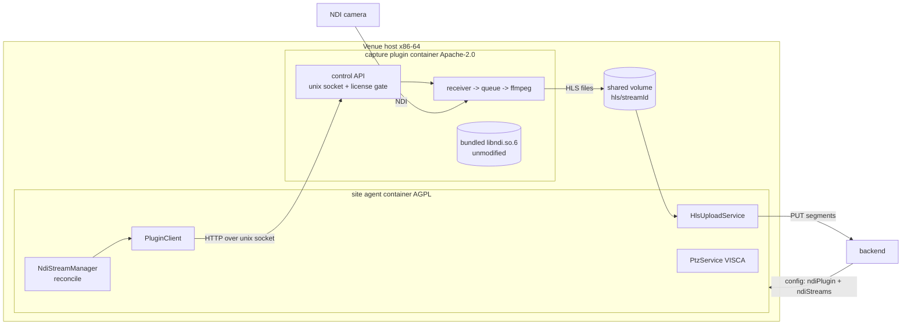

# Plan: NDI® capture as a separately licensed plugin with in-product license acceptance

Status: **phase 0 done (2026-10-18), phase 1 done (plugin repo), phase 2 in review (PR into `develop`).** Builds on the NDI feature
currently on `develop` (PR #156–#159, see `docs/ndi-ptz-plan.md`). The plugin repository
`Flo-Schilli/mynextscreen-capture-plugin` exists (public, Apache-2.0, created 2026-10-18).

## 1. Why

The NDI feature on `develop` works end to end, but its distribution model has three problems
(analysis 2026-10-18 against the NDI SDK License shipped in `@grandi/*/LICENSE`):

1. **AGPL vs. proprietary runtime.** The site agent (AGPL-3.0) loads `libndi.so.6` into its own
   process via the `grandi` addon. That makes a combined work with a proprietary library.
2. **We redistribute the NDI runtime** inside a public GHCR image. Phase 0 showed that this is
   permitted (SDK docs §4.2 and §4.5), but only if our distribution terms carry NDI's conditions
   (clause 3d), the license text ships with the binary, and we track the latest SDK (clause 2b).
   The current agent image has no such terms.
3. **Clause 1b (excluded "Products": locked appliances, fixed-purpose containers, embedded
   hardware including Linux)** applied to a Raspberry Pi used as a venue agent. Solved by scope:
   production is **x86-64 general-purpose hardware only** (section 2.1).

Goal: the AGPL agent contains **no NDI code and no NDI binaries**. NDI capture lives in a
separate, permissively licensed plugin container. The plugin image ships the **unmodified**
`libndi.so.6` under plugin terms that cover clause 3d. The plugin refuses to run until an
organisation admin has accepted the NDI SDK license and our plugin terms for that agent.

Out of scope: PTZ. VISCA has no NDI dependency and stays in the agent unchanged.

## 2. Phase 0 results (verified 2026-10-18)

**Loading mechanism**
- x64 `grandi.node`: RUNPATH `$ORIGIN`. arm64: RPATH `$ORIGIN`. Both are searched before
  `LD_LIBRARY_PATH`. grandi 2.0.2 loads the addon eagerly at import.
- Setting `process.env.LD_LIBRARY_PATH` at runtime does not work, and a `process.dlopen` preload
  does not help.
- A symlink next to `grandi.node` works: retrying the import in the same process succeeds once the
  target exists. Only relevant if a download model ever returns.
- `libndi` needs `libavahi-client3` and `libavahi-common3`. The plugin image installs them. No
  daemon is needed, discovery runs via `extraIPs`.

**SDK and license**
- The official SDK is only available at a moving "latest" URL
  (`https://downloads.ndi.tv/SDK/NDI_SDK_Linux/Install_NDI_SDK_v6_Linux.tar.gz`). There are no
  versioned URLs and the tarball sha changes with every release. There is no Linux redistributable
  runtime package (redist exists only for Windows).
- SDK 6.3.2.0 `libndi.so.6.3.2` is byte-identical to the one bundled in `@grandi/linux-x64` 2.0.2.
  A receive test via the SDK lib delivered 150 frames at 30.0 fps.
- SDK docs §4.2: "BINARY FILES … You may distribute these files within your application if your
  EULA terms cover the specific requirements…". §4.5: "You can of course include the NDI runtime
  within your application folder." Shipping libndi inside our image is therefore permitted,
  provided our plugin license terms cover clause 3d.
- EULA 1b excludes from "Products": fixed-purpose locked appliances (i), fixed-purpose restricted
  virtual/container environments (ii), embedded hardware with an embedded OS including Linux
  (iii). Using the SDK for these needs a commercial agreement with NDI. A download model does
  **not** solve 1b: it concerns where the software runs, not who downloads the runtime.

### 2.1 Decisions (2026-10-18)
1. **Production platform = x86-64 only** (general-purpose hardware, operator-controlled
   unrestricted Linux). The Raspberry Pi is used **only internally for development testing**
   (EULA 2a, "for the sole purpose of developing Products").
   - The plugin publishes **amd64 images only**. An arm64 build may be produced locally for dev
     tests and is **never pushed**.
   - Docs, README and dashboard state the supported platform. We never offer preconfigured locked
     devices (1b(i)).
   - The site agent itself (no NDI) stays multi-arch.
   - `h264_v4l2m2m` leaves the release scope. The encoder code may stay but is not a supported
     path. The Pi test is no longer a release blocker.
2. **No downloader.** The plugin image ships the unmodified `libndi.so.6` (from
   `@grandi/linux-x64`) per SDK docs §4.2, with `NOTICE`/plugin terms covering 3d,
   `libndi_licenses.txt` and the NDI license text. The **license acceptance stays** (section 5).

## 3. Target architecture

| Component | License | Contains | Ships NDI binaries |
|---|---|---|---|
| site agent (`apps/site-agent`) | AGPL-3.0 | control, HLS upload, PTZ, status reporting | **no**: grandi and FFmpeg removed from the image |
| capture plugin (separate repo `Flo-Schilli/mynextscreen-capture-plugin`) | Apache-2.0 plus NDI notices | grandi addon, **unmodified `libndi.so.6`**, slim FFmpeg, pipeline, license gate | **yes, unmodified runtime only**, amd64 image, under terms covering 3d |
| backend / dashboard | AGPL-3.0 | acceptance records, gating, UI | no |

**Why the process boundary keeps the AGPL clean:** the agent and the plugin are separate
programs that exchange plain JSON over a socket and HLS files on disk. No shared memory, no
linked code, no AGPL code in the plugin. The plugin may load a proprietary library because its
own license allows that.

**Naming:** the NDI trademark policy forbids "NDI" in a product name (clause 3f). The plugin is
called **"mynextscreen capture plugin"** (repo `Flo-Schilli/mynextscreen-capture-plugin`, image
`ghcr.io/flo-schilli/mynextscreen-capture-plugin`) and is described as "NDI®-compatible".

## 4. Plugin (separate repository)

### 4.0 Repository
**Decision (2026-10-18): the plugin lives in its own public repository
`Flo-Schilli/mynextscreen-capture-plugin` under Apache-2.0.** Reasons:
- **License clarity:** one license per repo. No mixed-license monorepo, and no way to import AGPL
  code into the plugin by accident. The separation is enforced by the repo boundary.
- **No NDI dependency left in this repo:** `grandi` leaves the root `package.json` and the
  lockfile, and the backend image no longer has to prune it. `tools/ndi-test-source` and
  `tools/ndi-spike` move with the plugin. `tools/visca-mock` stays here.
- **Own release cadence:** clause 2b ("latest SDK version") turns every SDK update into a plugin
  release, without a platform release.
- **Smaller surface here:** FFmpeg and grandi updates and CVEs only touch the plugin repo.

Trade-offs, and how we handle them:
- **Protocol types in two places:** the plugin repo is the source of truth and publishes
  `openapi.json` with each release. The agent keeps hand-synced types (same pattern as
  `protocol/server-protocol.ts`), and both sides run a contract test against the schema.
- **Duplicated CI** (build, Trivy, CodeQL, gitleaks, Dependabot): copy and trim the workflows from
  this repo. With amd64 only, the arm64 runner matrix is dropped.
- **Version compatibility:** the API is versioned (`/v1`). The agent reads `pluginVersion` and
  `apiVersion` from `GET /v1/status` and rejects an unknown major version with status
  `incompatible`. Ansible pins both image tags.
- **E2E across repos:** this repo's integration tests pull the pinned plugin image from GHCR.

**Visibility: public.** An Apache-2.0 plugin only makes sense as public open source. GitHub-hosted
CI and CodeQL are free on public repos, and a public GHCR image keeps today's credential-free pull.

**Rule for the repository tree and PR diffs: they never contain NDI SDK files** (headers, libs,
docs, archives). The SDK, its headers and documentation are "Confidential Information" under
clause 3a. The only NDI binary that reaches the image is the `libndi.so.6` that comes with the
`@grandi/linux-x64` npm package. Enforced three times:
- `.gitignore` entries for `libndi*`, `Processing.NDI.*.h`, `NDI SDK*/` and SDK archives.
- CI denylist on the **repo tree and PR diffs**: fails on any of those patterns.
- CI check on the **built image**: it must contain exactly the expected `libndi.so.6` (sha256
  equals the one from `@grandi/linux-x64`, pinned in the repo) and no headers and no SDK docs. The
  license text and `libndi_licenses.txt` are the only permitted SDK-derived documents, shipped
  under `/usr/share/licenses/capture-plugin/`.

Repo layout: a single TypeScript Node project. npm with `packageManager` pinned like here, Node 26,
Prettier, ESLint, Jest with gate 85/75/83/85, `Dockerfile`, `openapi.json`, `NOTICE`, `LICENSE`
(Apache-2.0), `CHANGELOG.md`, versioning via `npm version` and tags `v*.*.*`.

### 4.1 Code moved out of the agent
From `apps/site-agent/src/ndi/`: `grandi-binding.ts`, `ndi-receiver.ts`, `bounded-queue.ts`,
`ndi-transcoder.ts`, `ndi-ffmpeg-args.ts`, `ndi-encoder.ts`, `ndi-pipeline.ts`, `stream-id.ts`,
`testing/fake-ffmpeg.ts` plus specs, and `tools/ndi-test-source/` and `tools/ndi-spike/`. The
author is the sole copyright holder of this code (plus Dependabot bumps), so it can be relicensed
to Apache-2.0 when it moves. History may optionally be carried over with `git filter-repo`.
The plugin never imports code from this repo.

Framework: plain Node `http` server plus the moved services. NestJS is not needed for one socket
and a handful of routes.

### 4.2 License gate and bundled runtime
State machine reported in every status response:

`license_required` → (acceptance with matching hash) → `ready`. Other states: `error` (grandi load
failure, runtime missing), `incompatible` (unsupported platform or API major version).

- **Bundled runtime:** the image contains the unmodified `libndi.so.6` next to `grandi.node` (as
  shipped by `@grandi/linux-x64`, so `$ORIGIN` resolves it). Nothing is modified, repacked or
  stripped. The image installs `libavahi-client3` and `libavahi-common3`.
- **License text in the image:** `NDI SDK License Agreement.txt` of the bundled SDK version
  (currently sha256 `c49f407ee25f2bc31c8ea947f874c4c242b5bc2213176384b1838a84d9d5b3b0`), its
  `licenseSha256` computed at build time, plus `libndi_licenses.txt` and our plugin terms.
- **Acceptance input:** `PUT /v1/license { sdkVersion, licenseSha256 }`. This comes from the agent,
  which forwards it from the backend config or from the local fallback (section 6). The plugin
  rejects a hash that does not match the text it ships.
- **Gate:** until an acceptance with the matching hash is present, the plugin **refuses to start
  pipelines** (`409`) and does not import grandi.
- **Platform check:** the plugin refuses to start on a non-`x86_64` host (state `incompatible`)
  unless `MNS_CAPTURE_DEV_ALLOW_ARM=1` is set (dev only, documented as unsupported for production).
- **Version check** after load: `grandi.version()` must report major version 6.
- **Revocation:** acceptance removed in config → plugin stops all pipelines and returns to
  `license_required`.
- **License change:** a grandi/SDK bump changes the license-text hash. Existing acceptances no
  longer match, the state becomes `license_required` and the admin must accept again (section 6.3).

### 4.3 Control API (agent ↔ plugin)
HTTP/1.1 over a unix socket `/run/mns-capture/plugin.sock` on a shared volume. The directory has
mode 0700 and is owned by uid 1000. Both containers run as uid 1000 (`keep-id`), so filesystem
permissions are the authentication. A shared token in an env var is an optional second factor.
The contract is `openapi.json` in the plugin repo.

**Trust boundary.** The socket directory and the HLS directory are one volume shared by both
containers, owned by uid 1000 on both sides. Filesystem permissions are the only authentication:
whoever can write that volume can impersonate the plugin. The agent therefore treats everything
from it as untrusted. It checks that the socket path is a socket before connecting, validates and
clamps every plugin answer to the backend DTO limits before reporting it (unknown states and codes
become `error` / `internal_error`), and uploads only `index.m3u8` plus `seg_<run>_<n>.ts` files that
are regular files (no symlinks, `O_NOFOLLOW`) within 1 MiB (playlist) / 32 MiB (segment).

| Route | Purpose |
|---|---|
| `GET /v1/status` | `apiVersion`, plugin version, license state, sdkVersion, `{ sdkVersion, licenseSha256 }` of the shipped text (the agent forwards it to the backend), arch, available encoders |
| `PUT /v1/license` | accept `{ sdkVersion, licenseSha256 }`; `DELETE` = revoke |
| `GET /v1/license/text` | shipped license text and plugin terms (for the setup UI and the backend) |
| `PUT /v1/streams/:streamId` | start or replace a pipeline: `AgentNdiStreamConfig` without `ptz` (cameraHost, sourceName, bandwidth, size, fps, bitrate, encoderPref) |
| `DELETE /v1/streams/:streamId` | stop a pipeline |
| `GET /v1/streams` | per-stream status (`state`, `sourceName`, `encoder`, `fps`, `framesDropped`, error code) |

The plugin writes HLS to `/var/lib/mns-capture/hls/<streamId>/` on the shared volume. The existing
per-run segment names stay. The agent's `HlsUploadService` watches that directory instead of its
own temp dir.

## 5. Agent changes (`apps/site-agent`)
- `NdiStreamManager.reconcile()` calls `PluginClient` (`PUT`/`DELETE /v1/streams`) instead of
  creating pipelines in-process. Reconcile semantics stay, including that PTZ changes never
  restart video.
- New `PluginClient` with a socket-path seam for tests. It polls `GET /v1/status` and
  `GET /v1/streams` every 2 s. Plugin absent or socket missing → state `absent`, never an error
  loop. Unknown API major version → `incompatible`.
- Hand-synced protocol types (`protocol/capture-plugin-protocol.ts`, with a sync note pointing to
  the plugin repo's `openapi.json` and version) plus a contract spec against a vendored copy.
- License: forwards `config.ndiPlugin.acceptance` to the plugin (`PUT /v1/license`) and reports the
  plugin's state and shipped license hash to the backend.
- Report: new optional `capturePlugin` block (`state`, `pluginVersion`, `sdkVersion`,
  `licenseSha256`, `acceptedVia: 'dashboard' | 'device'`). Existing `ndiStreams` status is filled
  from the plugin. The older-server 400 fallback stays.
- Removed from the agent: grandi import, `ndi/` pipeline code, FFmpeg in the image (back to the
  slim pre-NDI size of about 137 MB), `/dev/video*`/`/dev/dri` needs (they move to the plugin).
  The agent image stays multi-arch.
- Root `package.json`/`package-lock.json`: `grandi` removed (lockfile regenerated in node:26 +
  npm 12.2.0). The prune step in `apps/backend/Dockerfile.prod`, the slim FFmpeg stage and the
  grandi/encoder smoke checks in `.github/workflows/ci.yml` are removed. A new smoke check asserts
  that no `libndi*` file and no `grandi` package exists in the agent image.
- `tools/ndi-test-source/` and `tools/ndi-spike/` are deleted here after they land in the plugin
  repo.

## 6. License acceptance flow ("Dashboard + Agent")
The accepted terms are the NDI SDK license **and** our plugin terms (clause 3d conditions),
identified by the hash of the exact shipped text.

### 6.1 Primary: dashboard
1. The agent reports `capturePlugin.state = license_required` with `sdkVersion` and `licenseSha256`.
2. The site-agent detail page shows a "Video capture plugin (NDI®-compatible)" card with state,
   plugin and SDK version, the supported-platform note (x86-64) and an **"Enable"** action for
   OrgAdmins only.
3. "Enable" opens a modal with the **full NDI license text** and our plugin terms (fetched via
   backend → agent → plugin `GET /v1/license/text`, or cached in the backend per `licenseSha256`),
   the trademark notice, a link to https://ndi.video and an unticked checkbox "I accept the NDI SDK
   License and the plugin terms on behalf of <organisation>". Accept is enabled only after scrolling
   to the end and ticking the box.
4. `POST /api/site-agents/:id/capture-plugin/acceptance { sdkVersion, licenseSha256 }` (OrgAdmin)
   → row in the new table `capture_plugin_acceptances` (`id`, `organisationId`, `agentId`,
   `sdkVersion`, `licenseSha256`, `acceptedByUserId`, `acceptedAt`, `revokedAt`, `revokedByUserId`)
   plus audit `site_agent.capture_license_accepted`. Then the backend pushes `reload_config`.
5. `AgentConfig.ndiPlugin = { acceptance: { sdkVersion, licenseSha256 } | null }` → agent →
   plugin → status `ready` → card shows "ready".
6. `DELETE …/acceptance` (OrgAdmin) revokes, with audit `site_agent.capture_license_revoked`.

### 6.2 Fallback: on the device (unattended / offline installs)
- Env `MNS_CAPTURE_ACCEPT_NDI_LICENSE=<licenseSha256>` on the **plugin** container, set via the
  ansible var `capture_plugin_accept_ndi_license_sha256`. Having to paste the hash forces the
  operator to look at the exact license version. A bare `true` is deliberately not accepted.
- Setup UI (port 8787) gets a page with the same license text and checkbox, for on-site installs
  without dashboard access.
- Device acceptance is reported (`acceptedVia: 'device'`) and shown in the dashboard as "accepted on
  the device" with a timestamp. The backend stores it as an acceptance row with
  `acceptedByUserId = null`, `source = 'device'`.

### 6.3 Gating
- Dashboard: source type "NDI" in the live-stream create modal is offered only for agents with
  `capturePlugin.state = ready`. Other agents are shown disabled with a reason.
- Backend: creating or activating an NDI stream for an agent without an active acceptance or whose
  plugin is not `ready` → `409` with a clear message. The existing NDI stream schema stays. Only
  gating is added.
- A new image with a new `licenseSha256` (after a grandi/SDK bump) → the card shows "new license
  version, acceptance required". Streams stop until the admin accepts again, because the plugin
  refuses to run without a matching hash.

## 7. Deployment
- Plugin repo CI (**amd64 only**): lint/typecheck/test, contract check of `openapi.json`, NDI
  denylist (repo tree, PR diff, image, section 4.0), image build, Trivy gate, CodeQL, gitleaks.
  Publishes `ghcr.io/flo-schilli/mynextscreen-capture-plugin` (amd64) only on main and tags. An
  arm64 image is built locally for dev tests and never pushed. Image base `node:26-trixie-slim`,
  with the slim FFmpeg stage moved there from the agent Dockerfile and `grandi` installed.
  Same hardening as the agent: rootless, `keep-id`, `DropCapability=ALL`, `NoNewPrivileges`,
  read-only rootfs plus tmpfs, host network (LAN access to the camera's NDI ports).
- CI smoke for the plugin image: the expected `libndi.so.6` is present (sha256 match), no headers
  or SDK docs, FFmpeg encoders (x264, vaapi), the plugin starts and reports `license_required`,
  `grandi.node` loads after acceptance.
- Ansible (this repo) pins `capture_plugin_image_tag` separately from `signage_image_tag`.
- Ansible: new optional quadlet `mynextscreen-capture-plugin.container.j2`, enabled by
  `capture_plugin_enabled: false` (default off), only for x86-64 hosts. Shared volumes
  `%h/capture/state` and `%h/capture/shared` (socket plus HLS, mounted into both containers).
  `AddDevice` for `/dev/dri` per inventory var, on the plugin only.
- Agent quadlet: mounts `%h/capture/shared` and gets `MNS_CAPTURE_SOCKET` set.
- Docs: install section with the supported platform, the NDI notice, the link and the acceptance
  steps. We never offer preconfigured locked devices.

## 8. Notices and terms (clause 2b / 3d / 3f)
- `NOTICE` in the plugin repo (also in the image under `/usr/share/licenses/capture-plugin/`, next
  to the NDI license text and `libndi_licenses.txt`): NDI copyright, "NDI® is a registered
  trademark of Vizrt NDI AB", link, and the 3d conditions (no modification or reverse engineering of
  NDI components, warranty and liability disclaimer on behalf of NDI, export compliance). The
  acceptance modal shows the same text.
- Repo `README`: the AGPL agent contains no NDI code, the plugin is Apache-2.0, the image ships the
  unmodified NDI runtime under the NDI license, supported platform is x86-64.
- Dashboard "About/Info": trademark notice plus link (still open from PR 2).
- Clause 2b ("latest SDK version"): a **weekly CI job** compares the grandi releases and the SDK
  "latest" URL (ETag / Last-Modified) against the pinned state and opens an issue when a newer SDK
  appears. We then bump grandi, rebuild and release the plugin, which changes the license hash if
  NDI changed the text (section 6.3).

## 9. Phases

| Phase | Content | Effort (rough) |
|---|---|---|
| **0 Verify** | **Done 2026-10-18** (section 2) | done |
| **1 Plugin repo** | **Done 2026-10-18** (plugin PRs #1, #3, #8). CI, tag-only GHCR publish (amd64), branch protection, NDI denylist (tree, diff, image sha256), moved pipeline + `tools/ndi-*` (relicensed), control API + `openapi.json`, license gate, platform check, bundled runtime + notices. **Released `v0.1.0`** (`ghcr.io/flo-schilli/mynextscreen-capture-plugin:0.1.0`) after phase 2 | done |
| **2 Agent** | **Done 2026-10-18** (#171). `PluginClient` + hand-synced types + contract spec, reconcile via the plugin (no orphan deletion before a real config), report block, hardened HLS pickup, grandi/FFmpeg/pipeline/`tools/ndi-*` removed, agent image back to Alpine (~135 MB compressed), smoke "no libndi, no grandi, no ffmpeg" | done |
| **3 Backend + dashboard** | migration `capture_plugin_acceptances`, acceptance API + audit, `AgentConfig.ndiPlugin`, gating (409), plugin card + acceptance modal, create-modal gating, i18n | 2–3 days |
| **4 Deployment** | ansible quadlet + vars (x86-64 only), setup-UI acceptance page, device env fallback, docs/NOTICE, weekly SDK check job | 1–2 days |
| **5 E2E** | rootless on x86-64: test source → plugin → agent → backend → player; acceptance/revocation/license-change paths. The Pi run (`h264_v4l2m2m`) is an optional dev test, not a release blocker | 1 day |

Delivery: plugin-repo work through PRs in the plugin repo; images are published only for version
tags. This repo keeps one PR per phase into `develop`. Phase 2 was built and tested against a
locally built plugin image; from phase 3 on, deployments pin the released plugin tag (`0.1.0`).

## 10. NDI licensing: no request to NDI (decision 2026-10-18)
**We deliberately do not ask NDI.** The use stays inside what the NDI SDK License and the SDK
documentation allow as written:
- **Production on x86-64 general-purpose hardware only**, with an operator-controlled, unrestricted
  Linux. That is the "Products" definition of clause 1b (*"general purpose operating systems … on
  general purpose computing platforms such as servers, desktops, and laptops on which the end user
  can freely change … the operating system"*).
- **Raspberry Pi only for internal development**, covered by clause 2a (*"for the sole purpose of
  developing Products"*). No arm64 plugin image is ever published, and the plugin refuses to run on
  non-x86-64 without `MNS_CAPTURE_DEV_ALLOW_ARM=1`.
- **Bundling the unmodified runtime** is permitted by SDK docs §4.2/§4.5 when our terms cover clause
  3d, which `NOTICE` does. The license acceptance (phase 3) is the consent to those terms.

Obligations that stay with us: follow new SDK releases (clause 2b; weekly `sdk-watch` in the plugin
repo), trademark use (clause 3f: no "NDI" in product names, notice + link), and never offer the
plugin on a preconfigured locked appliance (1b(i)).

Residual risk: a third party could run the public image on an excluded environment; that would be
their licensing matter, and our docs and the platform check state the intended use. If NDI ever
objects, the remedy is to withdraw the image. This is a reading of the license text, not legal
advice.

## 11. Risks

| Risk | Impact | Mitigation |
|---|---|---|
| NDI does not confirm the shipping model | public image cannot be released | SDK docs §4.2/§4.5 already permit it. If NDI objects: agreement or Advanced SDK, otherwise keep the plugin private |
| Third parties run the amd64-only plugin on arm64 or locked devices despite the docs (1b) | license breach on their side, reputational risk | docs and README state the platform, no arm64 images are published, platform check refuses to start on non-`x86_64` unless `MNS_CAPTURE_DEV_ALLOW_ARM=1` (dev only) |
| NDI changes terms with a new SDK / grandi release | acceptance no longer valid | acceptance is bound to the license-text hash. A changed hash puts the plugin in `license_required` until the admin accepts again |
| New SDK release not tracked (clause 2b) | stale runtime | weekly CI job on grandi releases and the SDK "latest" URL opens an issue |
| An NDI SDK file (header, doc, archive) lands in the repo, a PR or the image | breach of clause 3a | `.gitignore` + CI denylist on tree and diff, image check allows only the expected `libndi.so.6` (sha256) and the license texts |
| Two containers instead of one | more ops surface | plugin optional (default off), shared ansible role, status visible in the dashboard |
| Agent and plugin versions drift (two repos) | broken control calls in the field | `/v1` API versioning, `incompatible` status, contract tests on both sides, ansible pins both tags |
| Shared-socket misuse on the host | another local process controls the plugin | socket dir 0700 uid 1000, optional token, plugin accepts only the documented routes |
| HLS now crosses a volume | latency +ms | same host, tmpfs-backed volume. Measure in phase 5 (target still ≤ 4 s) |

## 12. Explicit non-goals
- No change to PTZ, the player, the HLS upload protocol to the backend, or the live-stream schema.
- No in-product purchase or licensing of the NDI Advanced SDK.
- No automatic acceptance on behalf of an organisation, ever.
- No arm64 production support, no preconfigured locked devices, no runtime downloader.
