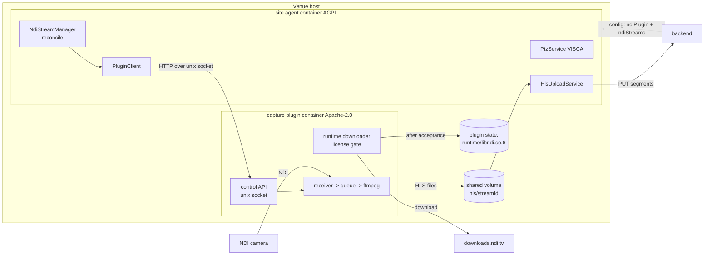

# Plan: NDI® capture as a separately licensed plugin with in-product license acceptance

Status: **plan only, nothing implemented.** Builds on the NDI feature currently on `develop`
(PR #156–#159, see `docs/ndi-ptz-plan.md`).

## 1. Why

The NDI feature on `develop` works end to end, but its distribution model has three problems
(analysis 2026-10-18 against the NDI SDK License shipped in `@grandi/*/LICENSE`):

1. **AGPL vs. proprietary runtime.** The site agent (AGPL-3.0) loads `libndi.so.6` into its own
   process via the `grandi` addon. That makes a combined work with a proprietary library.
2. **We redistribute the NDI runtime** inside a public GHCR image. Clause 2a only allows
   distribution "in accordance with the SDK Documentation", clause 3d requires our distribution
   terms to carry NDI's conditions, clause 2b requires the latest SDK version.
3. **Clause 1b(iii) (embedded devices)** is a grey zone for a Raspberry Pi used as a venue agent.

Goal: the AGPL agent contains **no NDI code and no NDI binaries**. NDI capture lives in a
separate, permissively licensed plugin process. The NDI runtime is **never shipped by us**: the
plugin downloads it from NDI only after an organisation admin has explicitly accepted the NDI
license for that agent. Problem 3 is not solved by architecture and stays a question for NDI
(section 9).

Out of scope: PTZ. VISCA has no NDI dependency and stays in the agent unchanged.

## 2. Target architecture

| Component | License | Contains | Ships NDI binaries |
|---|---|---|---|
| site agent (`apps/site-agent`) | AGPL-3.0 | control, HLS upload, PTZ, status reporting | **no**: grandi and FFmpeg removed from the image |
| capture plugin (separate repo `Flo-Schilli/mynextscreen-capture-plugin`) | Apache-2.0 | grandi addon (`grandi.node`), slim FFmpeg, pipeline, downloader | **no**: `libndi*.so` deleted at build time, CI asserts absence |
| NDI runtime | NDI SDK License | `libndi.so.6` | downloaded by the plugin on the venue host after acceptance |
| backend / dashboard | AGPL-3.0 | acceptance records, gating, UI | no |

**Why the process boundary keeps the AGPL clean:** the agent and the plugin are separate
programs that exchange plain JSON over a socket and HLS files on disk. No shared memory, no
linked code, no AGPL code in the plugin. The plugin may load a proprietary library because its
own license (Apache-2.0) allows that.

**Naming:** the NDI trademark policy forbids "NDI" in a product name (clause 3f). The plugin is
called **"mynextscreen capture plugin"** (repo `Flo-Schilli/mynextscreen-capture-plugin`, image
`ghcr.io/flo-schilli/mynextscreen-capture-plugin`) and is described as "NDI®-compatible".

## 3. Plugin (separate repository)

### 3.0 Repository
**Decision (2026-10-18): the plugin lives in its own repository, `Flo-Schilli/mynextscreen-capture-plugin`,
under Apache-2.0.** Reasons:
- **License clarity:** one license per repo, correctly detected by GitHub. No mixed-license
  monorepo, and no way to import AGPL code into the plugin by accident. The separation is
  enforced by the repo boundary rather than by convention, and it is easy to point NDI to.
- **No NDI dependency left in this repo:** `grandi` leaves the root `package.json` and the
  lockfile, and the backend image no longer has to prune it. `tools/ndi-test-source` and
  `tools/ndi-spike` move with the plugin (they use grandi and libndi). `tools/visca-mock` stays
  here, since PTZ stays in the agent.
- **Own release cadence:** clause 2b ("latest SDK version") turns every SDK update into a plugin
  release, without a platform release.
- **Smaller surface here:** FFmpeg and grandi updates and CVEs only touch the plugin repo.

Trade-offs, and how we handle them:
- **Protocol types in two places:** the plugin repo is the source of truth and publishes
  `openapi.json` with each release. The agent keeps hand-synced types (same pattern as
  `protocol/server-protocol.ts`), and both sides run a contract test against the schema. A
  separate npm package is not worth it for six routes.
- **Duplicated CI** (multi-arch build, Trivy, CodeQL, gitleaks, Dependabot): copy and trim the
  workflows from this repo, about half a day once.
- **Version compatibility:** the API is versioned (`/v1`). The agent reads `pluginVersion` and
  `apiVersion` from `GET /v1/status` and rejects an unknown major version with a clear status
  (`incompatible`) instead of misbehaving. Ansible pins both image tags.
- **E2E across repos:** this repo's integration tests pull the pinned plugin image from GHCR.
  The plugin repo tests against the agent only through the contract test.

**Visibility (decision 2026-10-18): public**, like this repo.
- An Apache-2.0 plugin only makes sense as public open source, and the whole point is a clean
  separation from the AGPL agent.
- CI stays free like today: GitHub-hosted runners (including `ubuntu-24.04-arm` for the arm64
  builds) and CodeQL code scanning cost nothing on public repos. Private repos pay for both.
- Public repo + public GHCR image keeps today's model, so venues pull without credentials.
- It shows NDI directly that neither the repo nor the image contains NDI binaries.

**Rule for the public repo: it never contains NDI SDK files.** The SDK, its headers and its
documentation are "Confidential Information" under clause 3a. The repo uses NDI only through
the `grandi` npm package and vendors nothing. This is enforced twice:
- `.gitignore` entries for `libndi*`, `Processing.NDI.*.h`, `NDI SDK*/` and SDK archives.
- A CI denylist check that fails the build if any of these patterns exist in the repository
  tree, in a PR diff, or in the built image. In the image it asserts no `libndi*` and no
  `Processing.NDI.*.h`; the downloaded runtime lives only in the venue's state volume.

Repo layout: a single TypeScript Node project. No Nx is needed for one app. npm with
`packageManager` pinned like here, Node 26, Prettier, ESLint, Jest with gate 85/75/83/85,
`Dockerfile`, `openapi.json`, `NOTICE`, `LICENSE` (Apache-2.0), `CHANGELOG.md`, versioning via
`npm version` and tags `v*.*.*` (same scheme as this repo).

### 3.1 Code moved out of the agent
From `apps/site-agent/src/ndi/`: `grandi-binding.ts`, `ndi-receiver.ts`, `bounded-queue.ts`,
`ndi-transcoder.ts`, `ndi-ffmpeg-args.ts`, `ndi-encoder.ts`, `ndi-pipeline.ts`, `stream-id.ts`,
`testing/fake-ffmpeg.ts` plus specs, and `tools/ndi-test-source/` and `tools/ndi-spike/`. The
author is the sole copyright holder of this code (all commits are by the author, plus Dependabot
dependency bumps), so it can be relicensed to Apache-2.0 when it moves. History may optionally be
carried over with `git filter-repo`; relicensing does not depend on it. The plugin never imports
code from this repo.

Framework: plain Node `http` server plus the moved services. NestJS is not needed for one
socket and a handful of routes.

### 3.2 License gate and runtime downloader
State machine reported in every status response:

`license_required` → (acceptance with matching hash) → `downloading` → `verifying` → `ready`.
Error states: `download_failed`, `checksum_mismatch`, `sdk_changed`, `load_failed`, all with
backoff and retry.

- **Pinned SDK catalogue** in the plugin image (data, not binaries), per supported SDK release:
  `sdkVersion`, official download URL, `tarballSha256`, path of `libndi.so.6` per arch inside the
  archive (`x86_64-linux-gnu`, `aarch64-…`), and the **full NDI license text** of that release
  plus its `licenseSha256`. Redistributing the license text is fine. Redistributing the binary is not.
- **Acceptance input:** `PUT /v1/license { sdkVersion, licenseSha256 }`. This comes from the agent,
  which forwards it from the backend config or from the local fallback (section 5). The plugin
  rejects a hash that does not match its catalogue entry.
- **Download:** HTTPS from the catalogue URL. The plugin streams the tarball to a temp file in its
  state volume, verifies `tarballSha256`, extracts **only** `libndi.so.6` for the host arch plus
  the license files, and writes them to `/var/lib/mns-capture/runtime/<sdkVersion>/` (mode 0700).
  It never runs the SDK's install script. It deletes the tarball afterwards. It then verifies that
  the license file inside the archive hashes to the accepted `licenseSha256`. A mismatch means NDI
  changed the license, so the plugin goes to `sdk_changed` and acceptance is required again.
- **Loading:** the grandi addon is imported lazily (as today) only in state `ready`, with
  `LD_LIBRARY_PATH=/var/lib/mns-capture/runtime/<sdkVersion>`. The image deletes the
  `libndi*.so` that `@grandi/linux-*` ships next to `grandi.node`, so the loader falls back to
  `LD_LIBRARY_PATH`. **Must be verified in phase 0** (RPATH vs. RUNPATH of `grandi.node`).
- **Version check** after load: `grandi.version()` must report the accepted major version 6. Newer
  6.x minors are expected to be ABI compatible (same soname). Verified in phase 0.
- **Revocation:** acceptance removed in config → plugin stops all pipelines, deletes the runtime
  directory and returns to `license_required`.

### 3.3 Control API (agent ↔ plugin)
HTTP/1.1 over a unix socket `/run/mns-capture/plugin.sock` on a shared volume. The directory has
mode 0700 and is owned by uid 1000. Both containers run as uid 1000 (`keep-id`), so filesystem
permissions are the authentication. A shared token in an env var is an optional second factor.
The contract is `openapi.json` in the plugin repo (section 3.0). The agent keeps hand-synced
types plus a contract test.

| Route | Purpose |
|---|---|
| `GET /v1/status` | `apiVersion`, plugin version, license state, sdkVersion, catalogue `{ sdkVersion, licenseSha256 }` (the agent forwards these to the backend), arch, available encoders |
| `PUT /v1/license` | accept `{ sdkVersion, licenseSha256 }`; `DELETE` = revoke |
| `GET /v1/license/text?sdkVersion=` | license text from the catalogue (for the setup UI and the backend) |
| `PUT /v1/streams/:streamId` | start or replace a pipeline: `AgentNdiStreamConfig` without `ptz` (cameraHost, sourceName, bandwidth, size, fps, bitrate, encoderPref) |
| `DELETE /v1/streams/:streamId` | stop a pipeline |
| `GET /v1/streams` | per-stream status (`state`, `sourceName`, `encoder`, `fps`, `framesDropped`, error code) |

The plugin writes HLS to `/var/lib/mns-capture/hls/<streamId>/` on the shared volume. The
existing per-run segment names stay. The agent's `HlsUploadService` watches that directory instead of its own temp dir.

## 4. Agent changes (`apps/site-agent`)
- `NdiStreamManager.reconcile()` calls `PluginClient` (`PUT`/`DELETE /v1/streams`) instead of
  creating pipelines in-process. The reconcile semantics stay the same, including that PTZ changes
  never restart video.
- New `PluginClient` with a socket-path seam for tests. It polls `GET /v1/status` and `GET /v1/streams` every 2 s. Plugin
  absent or socket missing → state `absent`, never an error loop. Unknown API major version →
  state `incompatible`.
- Hand-synced protocol types (`protocol/capture-plugin-protocol.ts`, with a sync note pointing
  to the plugin repo's `openapi.json` and its version) plus a contract spec that validates the
  agent's requests and the fixtures against a vendored copy of `openapi.json`.
- License: forwards `config.ndiPlugin.acceptance` to the plugin (`PUT /v1/license`) and reports the
  plugin's state and catalogue to the backend.
- Report: new optional `capturePlugin` block (`state`, `pluginVersion`, `sdkVersion`, `catalogue`,
  `acceptedVia: 'dashboard' | 'device'`). Existing `ndiStreams` status is filled from the plugin.
  The older-server 400 fallback stays.
- Removed from the agent: grandi import, `ndi/` pipeline code, FFmpeg in the image (back to the
  slim pre-NDI image size of about 137 MB), `/dev/video*`/`/dev/dri` needs (they move to the plugin).
- Root `package.json`/`package-lock.json`: `grandi` removed (lockfile regenerated in node:26 +
  npm 12.2.0). The prune step in `apps/backend/Dockerfile.prod`, the slim FFmpeg stage and the
  grandi/encoder smoke checks in `.github/workflows/ci.yml` are removed from this repo. A new
  smoke check asserts that no `libndi*` file and no `grandi` package exists in the agent image.
- `tools/ndi-test-source/` and `tools/ndi-spike/` are deleted here after they land in the
  plugin repo.

## 5. License acceptance flow ("Dashboard + Agent")

### 5.1 Primary: dashboard
1. The agent reports `capturePlugin.state = license_required` with the catalogue entry.
2. The site-agent detail page shows a "Video capture plugin (NDI®-compatible)" card with state,
   plugin and SDK version, and an **"Enable"** action for OrgAdmins only.
3. "Enable" opens a modal with the **full NDI license text** (fetched via backend → agent → plugin
   `GET /v1/license/text`, or cached in the backend per `licenseSha256`). It also shows our plugin
   terms (clause 3d conditions), the trademark notice, a link to https://ndi.video and an unticked
   checkbox "I accept the NDI SDK License on behalf of <organisation>". Accept is enabled only after
   scrolling to the end and ticking the box.
4. `POST /api/site-agents/:id/capture-plugin/acceptance { sdkVersion, licenseSha256 }` (OrgAdmin)
   → row in the new table `capture_plugin_acceptances` (`id`, `organisationId`, `agentId`,
   `sdkVersion`, `licenseSha256`, `acceptedByUserId`, `acceptedAt`, `revokedAt`, `revokedByUserId`)
   plus audit `site_agent.capture_license_accepted`. Then the backend pushes `reload_config`.
5. `AgentConfig.ndiPlugin = { acceptance: { sdkVersion, licenseSha256 } | null }` → agent →
   plugin downloads → status `ready` → card shows "ready".
6. `DELETE …/acceptance` (OrgAdmin) revokes, with audit `site_agent.capture_license_revoked`.

### 5.2 Fallback: on the device (unattended / offline installs)
- Env `MNS_CAPTURE_ACCEPT_NDI_LICENSE=<licenseSha256>` on the **plugin** container, set via the
  ansible var `capture_plugin_accept_ndi_license_sha256`. Having to paste the hash forces the
  operator to look at the exact license version. A bare `true` is deliberately not accepted.
- Setup UI (port 8787) gets a page with the same license text and checkbox, for on-site installs
  without dashboard access.
- Device acceptance is reported (`acceptedVia: 'device'`) and shown in the dashboard as "accepted on
  the device" with a timestamp. The backend stores it as an acceptance row with
  `acceptedByUserId = null`, `source = 'device'`.

### 5.3 Gating
- Dashboard: source type "NDI" in the live-stream create modal is offered only for agents with
  `capturePlugin.state = ready`. Other agents are shown disabled with a reason.
- Backend: creating or activating an NDI stream for an agent without an active acceptance or whose
  plugin is not `ready` → `409` with a clear message. The existing NDI streams on `develop` keep
  their schema. Only gating is added.
- A new SDK release with a new `licenseSha256` → the card shows "new license version, acceptance
  required". Existing streams keep running on the old runtime until the admin accepts, and are not
  silently upgraded.

## 6. Deployment
- Plugin repo CI (built natively per arch, amd64 + arm64, like this repo): lint/typecheck/test,
  contract check of `openapi.json`, NDI-SDK denylist check (repo tree, PR diff, image), image
  build, Trivy gate, CodeQL, gitleaks. Publishes
  `ghcr.io/flo-schilli/mynextscreen-capture-plugin` only on main and tags. Image base
  `node:26-trixie-slim`, with the slim FFmpeg stage moved there from the agent Dockerfile,
  `grandi` installed and then `rm @grandi/linux-*/libndi*`. Same hardening as the agent:
  rootless, `keep-id`, `DropCapability=ALL`, `NoNewPrivileges`, read-only rootfs plus tmpfs,
  host network (the plugin needs LAN access to the camera's NDI ports).
- CI smoke for the plugin image: no `libndi*` in the image (hard fail), FFmpeg encoders per arch,
  the plugin starts and reports `license_required`, `grandi.node` present.
- Ansible (this repo) pins `capture_plugin_image_tag` separately from `signage_image_tag`.
- Ansible: new optional quadlet `mynextscreen-capture-plugin.container.j2`, enabled by
  `capture_plugin_enabled: false` (default off). Shared volumes `%h/capture/state` (runtime,
  mode 0700) and `%h/capture/shared` (socket plus HLS, mounted into both containers). `AddDevice`
  for `/dev/video*` (Pi) or `/dev/dri` (x86) per inventory var, on the plugin only.
- Agent quadlet: mounts `%h/capture/shared` and gets `MNS_CAPTURE_SOCKET` set.
- Docs: install section with the NDI notice, the link and the acceptance steps.

## 7. Notices and terms (clause 3d / 3f)
- `apps/capture-plugin/NOTICE` (also in the image under `/usr/share/licenses/capture-plugin/`):
  NDI copyright, "NDI® is a registered trademark of Vizrt NDI AB", link, and the 3d conditions
  (no modification or reverse engineering of NDI components, warranty and liability disclaimer on
  behalf of NDI, export compliance). The acceptance modal shows the same text.
- Repo `README`: state that the AGPL agent contains no NDI code, the plugin is Apache-2.0, and
  the NDI runtime is obtained from NDI under the NDI license.
- Dashboard "About/Info": trademark notice plus link (still open from PR 2).
- Process for clause 2b ("latest SDK version"): a weekly CI job checks the catalogue download URL
  (ETag / Last-Modified / checksum). On a change it opens an issue, and we then add the new release
  to the catalogue.

## 8. Phases

| Phase | Content | Effort (rough) |
|---|---|---|
| **0 Verify** (blocking) | (a) `grandi.node` finds `libndi.so.6` via `LD_LIBRARY_PATH` when deleted next to it, on x64 and arm64; (b) official NDI SDK Linux download: URL stability, archive layout, aarch64 libs, license file location, whether the tarball is checksum-stable; (c) a newer 6.x libndi works with grandi 2.0.2; (d) send the NDI questions (section 9) | 1 day + NDI's response time |
| **1 Plugin repo** | create the public repo (Apache-2.0, CI and GHCR publish, branch protection, NDI-SDK denylist check), move pipeline code and `tools/ndi-*` (relicensed), control API + `openapi.json`, license state machine, downloader, specs, first release `v0.1.0` | 3.5–4.5 days |
| **2 Agent** | `PluginClient` + hand-synced types + contract spec, reconcile via the plugin, report block, remove grandi/FFmpeg/pipeline/`tools/ndi-*` from this repo, image smoke "no libndi, no grandi" | 1–2 days |
| **3 Backend + dashboard** | migration `capture_plugin_acceptances`, acceptance API + audit, `AgentConfig.ndiPlugin`, gating (409), plugin card + acceptance modal, create-modal gating, i18n | 2–3 days |
| **4 Deployment** | plugin image + CI matrix + smoke, ansible quadlet + vars, setup-UI acceptance page, device env fallback, docs/NOTICE, weekly SDK check job | 1–2 days |
| **5 E2E** | rootless: test source → plugin → agent → backend → player; acceptance/revocation/license-change paths; Pi run (`h264_v4l2m2m`, ≥ 38 min) | 1 day |

Delivery: plugin-repo work through PRs in the plugin repo. This repo keeps one PR per phase
into `develop`. Phase 2 in this repo requires a published plugin release from phase 1, so the
agent and the integration tests have a pinned image. Phase 0 is decided before any code moves. If NDI answers that shipping the runtime in the image is fine, phases 1–2 still pay
off for the AGPL separation, and the downloader becomes optional.

## 9. Questions for NDI (licensing@ndi.video), part of phase 0
1. May an open-source plugin (Apache-2.0) **download the NDI 6 SDK for Linux from your official URL on
   the end user's machine** after the end user has explicitly accepted the NDI SDK License in our
   UI, and extract only `libndi.so.6` for runtime use? Or is there a redistributable runtime
   package for Linux we should use instead?
2. Does a capture agent running on **customer-owned Raspberry Pi or x86 machines with an unrestricted,
   user-modifiable Linux** qualify as a "Product", or does it fall under 1b(iii) (embedded devices)?
3. Is the end user (venue operator) or we as the project the licensee in this model, and which
   terms must our plugin license carry under 3d?
4. Does the Standard SDK have any runtime limitation on Linux ARM64? (We measured none on x86-64:
   38 min, 68 402 frames.)

## 10. Risks

| Risk | Impact | Mitigation |
|---|---|---|
| `grandi.node` only finds libndi via `$ORIGIN` (RPATH) | the downloader design breaks | phase 0 (a). Fallback: copy the downloaded lib next to `grandi.node` into a writable overlay dir and point Node's module resolution there |
| NDI changes the tarball at a versionless URL | download fails (`checksum_mismatch`) | weekly CI check, catalogue update, clear plugin status in the dashboard |
| NDI says the download model is not acceptable either | feature cannot ship publicly | ask before implementing (phase 0). Alternatives: NDI's own redistributable, or an agreement / Advanced SDK |
| 1b(iii) applies to the Pi | Pi deployments not covered | NDI answer. If needed, support x86 only or obtain an agreement |
| Two containers instead of one | more ops surface | plugin optional (default off), shared ansible role, status visible in the dashboard |
| An NDI SDK file (header, lib, doc) lands in the public repo or image | breach of the SDK confidentiality clause 3a | `.gitignore` + CI denylist on tree, diff and image; repo vendors nothing from the SDK |
| Agent and plugin versions drift (two repos) | broken control calls in the field | `/v1` API versioning, `incompatible` status, contract tests on both sides, ansible pins both tags |
| Shared-socket misuse on the host | another local process controls the plugin | socket dir 0700 uid 1000, optional token, plugin accepts only the documented routes |
| Raw-frame path unchanged, but HLS now crosses a volume | latency +ms | same host, tmpfs-backed volume. Measure in phase 5 (target still ≤ 4 s) |

## 11. Explicit non-goals
- No change to PTZ, the player, the HLS upload protocol to the backend, or the live-stream schema.
- No in-product purchase or licensing of the NDI Advanced SDK.
- No automatic acceptance on behalf of an organisation, ever.
